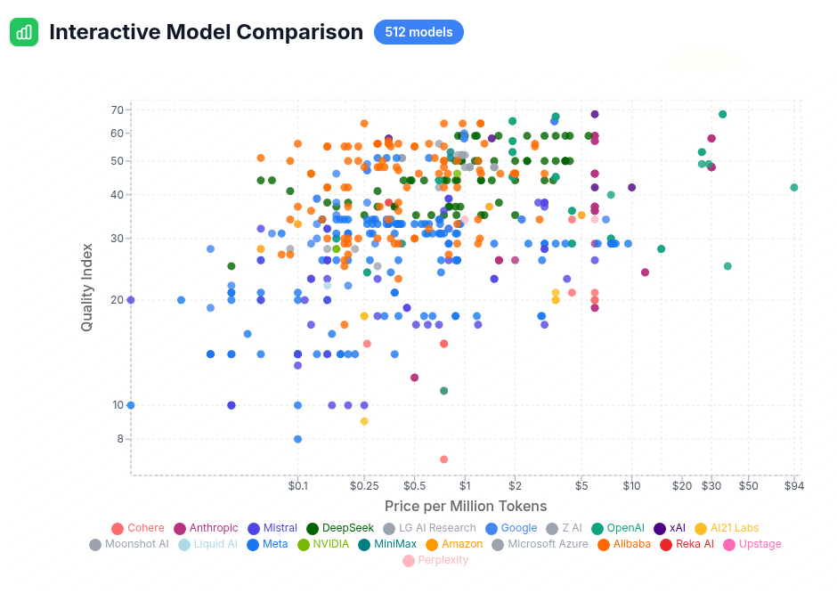
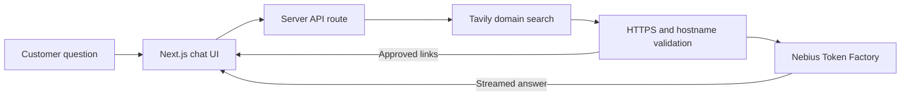

# Cool Apps and Demos built with Nebius AI

  - [WhatLLM](#whatllm)
  - [Allycat](#allycat)
  - [Customer Support AI](#customer-support-ai)
  - [Splitter Lite](#splitter-lite)

## WhatLLM

A cool and very useful LLM comparision tool

[whatllm.org](https://www.whatllm.org/)

Built by Dylan Bristot: [demianarc](https://github.com/demianarc)  |  [demian_ai](https://twitter.com/demian_ai)

| 
|-

---

## Allycat

[Allycat](https://github.com/The-AI-Alliance/allycat) can scrape a website, index its contents and allow chatting with the website content using LLMs running on Nebius Token Factory or locally.

Author: [sujee](https://github.com/sujee) | [sujee.dev](https://sujee.dev/) 

| 
|-

---

## Customer Support AI

[Customer Support AI](https://github.com/amrrs/customer-support-ai) is an
enterprise-style Next.js demo for building a conversational support assistant
with Nebius Token Factory and Tavily. It streams Markdown responses, supports
same-session follow-up questions, and restricts retrieval to a domain selected
by the user.

The server validates every retrieved URL before its excerpt can enter model
context, and the interface hyperlinks answers only to those approved sources.
The demo can be run locally or deployed to Vercel or Render.

Built by [Amrrs](https://github.com/amrrs).

---

## Splitter Lite

[Splitter Lite](splitter-lite/) is a Next.js bill-splitting app. Upload one
or two bills, say who had what in plain English, and NVIDIA Nemotron 3.5 Super
VL on Nebius Token Factory reads every line into structured JSON, then works
out each share by calling calculator tools. The app re-checks the model's
shares and flags any split that doesn't add up.

| 
|-

Built by [Amitesh Anand](https://github.com/Astrodevil).

---
